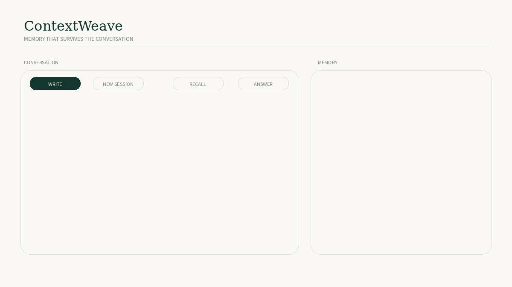
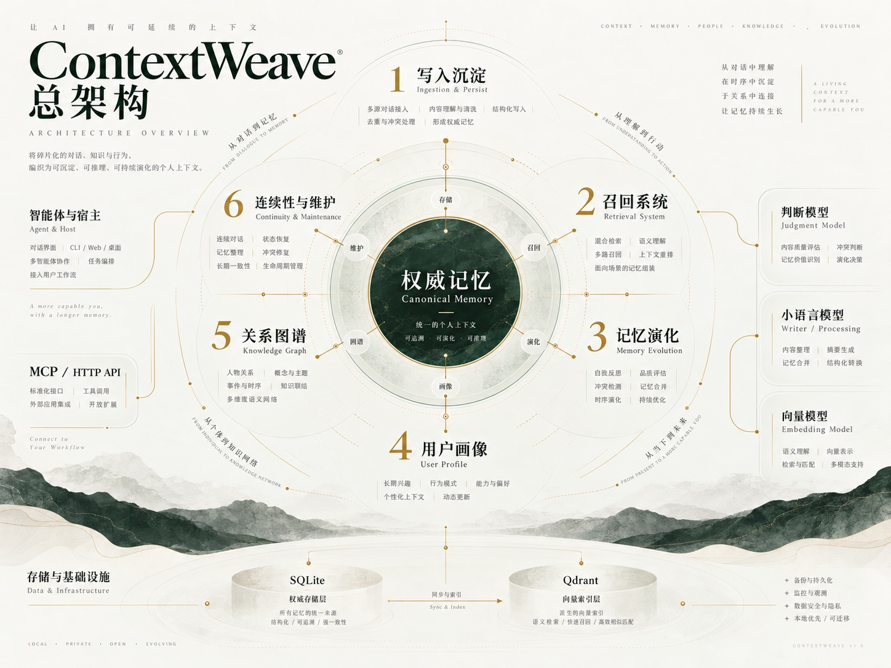

# ContextWeave

**Long-term memory infrastructure for AI agents.**

[](https://github.com/Lucien-rose/contextweave/actions/workflows/ci.yml)


[](LICENSE)

**English** · [简体中文](README.zh-CN.md)

---

> **AI agents can remember a conversation.**  
> **ContextWeave helps them remember a life.**

ContextWeave is a self-hosted long-term memory backend for AI agents that need continuity across sessions, models, and applications.

Instead of treating memory as a pile of static text chunks, ContextWeave keeps records that can evolve, retain their evidence, and be retrieved selectively. It separates canonical storage from optional retrieval indexes, so an agent can revisit an original source without loading an entire conversation history into every prompt.

<p align="center">
  
</p>

It is a backend, not a chat frontend. Hosts decide what to ingest, when to recall, and where returned context belongs.

## Why ContextWeave?

Long-running agents encounter problems that ordinary chat history and simple vector search do not solve on their own.

A preference changes. Two similar events need to coexist. A long source contains one relevant sentence. A new session needs a compact handoff. A summary survives, but its original evidence has disappeared.

ContextWeave is designed around four principles:

**Memory should evolve.** Changes, corrections, coexistence, and reviewable Lineage histories are explicit rather than silently overwriting the past.

**Recall should be selective.** Direct matches take priority; bounded supporting and background memories are optional. No relevant memory is also a valid result. Long records can open onto a relevant original-text window.

**Memory should remain traceable.** Source evidence, change receipts, and progressive navigation preserve routes from recalled cues back to canonical records.

**Continuity should survive a session.** Portraits, Session Capsules, and host-managed handoffs carry useful context forward without replaying a full archive.

## Features

| Area | What it provides |
| --- | --- |
| **Progressive recall** | Direct, supporting and associative retrieval with explicit context budgets, optional vector search and semantic judgment. |
| **Evidence and source context** | Canonical records, original-text windows, source references and inspectable provenance. |
| **Lineage and lifecycle** | Revisions, coexistence, family branches, change receipts, review proposals and deletion handling. |
| **Portraits** | Stable, medium-term and temporary context with separate lifecycles and bounded processing. |
| **Atlas navigation** | Read-only relationship leads, entities, relations and evidence paths. |
| **Session continuity** | Session Capsules, continuity checkpoints and compact host handoffs. |
| **Maintenance** | Offline Steward batches, daily/weekly health checks, backups and index migration/rollback. |
| **Portability** | Owner JSON export, transactional memory-package import and authoritative database snapshots. |

Optional model routes can assist ambiguous recall, portrait processing and maintenance. They are not required for local SQLite recall, and provider failure must not silently rewrite canonical memory.

## Architecture

<p align="center">
  
</p>

**SQLite is the source of truth.** Qdrant and embeddings are optional, rebuildable retrieval infrastructure. The host retains responsibility for conversation ingestion, session state, prompt composition, context placement and frontend behavior.

See [Architecture](docs/ARCHITECTURE.md) and [Host Integration](docs/HOST_INTEGRATION.md).

## Retrieval evaluation

Three clean isolated provider-backed runs used a frozen synthetic corpus of 80 ordered events and 106 held-out questions (`k=5`). Every system received the same records and the same configured neural embedding route. The complete ContextWeave route also ran semantic judgment, Lineage, Entity Registry links, progressive T0/T1/T2 recall, Answer Authority, packing and associative expansion; semantic judgment was applied on 106/106 questions in every run. Values below are three-run means.

| System | Top-1 | MRR@5 | Strict evidence precision | Evidence recall | Strict no-context abstention |
| --- | ---: | ---: | ---: | ---: | ---: |
| SQLite FTS5 / BM25 | 75.4% | 0.855 | 17.9% | 100.0% | 43.3% |
| Neural vector only | 38.2% | 0.490 | 15.2% | 68.4% | 86.7% |
| FTS + neural vector | 72.0% | 0.810 | 16.5% | 94.8% | 43.3% |
| **ContextWeave full pipeline** | **97.4%** | **0.986** | **22.8%** | **100.0%** | **86.7%** |

Against the strongest Top-1 baseline in each run, ContextWeave improved Top-1 retrieval by a mean **22.0 percentage points** and MRR@5 by **0.131**, while preserving 100% evidence recall. ContextWeave Top-1 was 97.4% in all three runs; MRR@5 ranged from 0.985 to 0.987.

This is a retrieval benchmark, not a claim about final answer generation, privacy-policy behavior or production-user generalization. Strict non-gold context incidence remains in the detailed diagnostic report, not the headline table: it currently mixes useful T1/T2 context with genuine noise and can reward systems that simply under-retrieve. See the [three-run report](evaluation/PROVIDER_BENCHMARK_2026-10-27.md), [protocol](evaluation/BENCHMARK_PLAN.md) and [reproduction guide](evaluation/README.md).

## Quick start

With Docker Compose (no host Node.js needed):

```sh
git clone https://github.com/Lucien-rose/contextweave.git
cd contextweave
mkdir -p imports
docker compose up --build -d --wait
docker compose exec contextweave moss doctor
```

The first start initializes persistent storage and separate runtime/admin credentials. Follow the [Docker guide](docs/DOCKER.md) to retrieve tokens, import your JSON package and run the complete host example.

For a native installation:

Requires **Node.js 24+** and npm. No paid model or Qdrant installation is needed for basic recall.

```sh
git clone https://github.com/Lucien-rose/contextweave.git
cd contextweave
npm ci

export MOSS_CONFIG_DIR="$PWD/data/config"
npm run init
export MOSS_ADMIN_TOKEN=$(node -e 'process.stdout.write(require("node:crypto").randomBytes(32).toString("hex"))')
export MOSS_RUNTIME_TOKEN=$(node -e 'process.stdout.write(require("node:crypto").randomBytes(32).toString("hex"))')
npm start
```

The HTTP server binds to `127.0.0.1:2091` by default. `GET /health` is unauthenticated and returns health/version only. Agents connect to `/mcp/runtime` with `MOSS_RUNTIME_TOKEN`; operators use `/mcp/admin` and legacy `/api/` routes with `MOSS_ADMIN_TOKEN`. The combined `/mcp` route remains temporarily available for compatibility. Persist both tokens securely for restarts; use TLS for remote access.

For local MCP process transport:

```sh
npm run start:stdio:runtime
# In a separate owner/operator client:
npm run start:stdio:admin
```

See [MCP surfaces](docs/MCP_SURFACES.md) for the runtime/admin tool boundary and legacy migration path.

For a synthetic recall demonstration and integration tests:

```sh
npm run demo
npm test
```

## Import existing memories after deployment

ContextWeave accepts a local JSON memory package with a read-only preview before any writes. It supports new records, duplicate detection, conflict reporting, and transactional apply. Existing canonical memories are never silently overwritten.

Example `memories.json`:

```json
{
  "format": "contextweave-memory-package",
  "version": 1,
  "memories": [
    {
      "title": "Travel preference",
      "content": "Prefers quiet trips with no more than two major stops per day.",
      "kind": "preference",
      "tags": ["travel"]
    }
  ]
}
```

From an initialized local installation, with the backend stopped before applying changes:

```sh
# Preview only; no database changes.
npm run memory:import -- ./memories.json --db ./data/moss-memory.sqlite

# After making a verified database backup and reviewing the preview:
npm run memory:import -- ./memories.json --db ./data/moss-memory.sqlite --apply
```

Conflicts and invalid records block apply by default. To import only safe new records after reviewing the report, use `--apply --skip-problems`. Vector jobs are queued for later synchronization.

For the **systemd installer**, use the `moss` service account and the deployed database path. The full copy/stop/backup/preview/apply/restart sequence is in [Memory Import](docs/MEMORY_IMPORT.md).

**Import is not full restore.** An owner JSON export may be partially imported as memory records and evidence excerpts; Lineage history, portraits, source material bodies, continuity and tombstones require an authoritative [database snapshot restore](docs/OPERATIONS.md#backup-and-restore). Keep memory packages private.

## Deploy and operate

For Linux/systemd, place the distribution at `/opt/moss-memory`, then run:

```sh
sudo bash deploy/moss-backend-install.sh
```

The installer sets up the service account, owner token, encrypted model-key storage, backend service and health timers. It does not install a reverse proxy or Qdrant. See [Operations](docs/OPERATIONS.md) for configuration, backup/restore and upgrades.

## Optional models and vector retrieval

The backend works with local SQLite recall alone. To enable model-assisted semantic judgment, embeddings or Qdrant, configure and test the relevant connections explicitly. Model routes and credentials are managed separately; credentials are encrypted at rest.

Read [Model Runtime](docs/MODEL_RUNTIME.md), [Configuration](docs/CONFIGURATION.md) and [Vector & Health](docs/VECTOR_AND_HEALTH.md).

## Integrating a host

ContextWeave does not automatically read an entire host conversation archive. The host sends selected signals or batches, decides when to request memory, confirms delivery when appropriate, and places returned context into the model prompt.

MCP tool names and compatibility variables such as `moss_*` and `MOSS_*` remain supported.

Application clients can use [HTTP API v1](docs/HTTP_API_V1.md): `ingest`, `recall`
and `evolve`, with context-checked reads and delivery receipts. Set `MOSS_RUNTIME_TOKEN`
and run `npm run example:http` against a running backend for a synthetic end-to-end example.
TypeScript and Python SDKs are planned after contract review.

See [API](docs/API.md), [Host Integration](docs/HOST_INTEGRATION.md), [Agent Integration](docs/AGENT_INTEGRATION.md) and the schema-generated [Tools Reference](docs/TOOLS.md). Live `tools/list` is authoritative after configuration overrides.

## Documentation

| Document | Topic |
| --- | --- |
| [Architecture](docs/ARCHITECTURE.md) | System boundaries and module ownership |
| [API](docs/API.md) | HTTP and MCP endpoints |
| [Memory Import](docs/MEMORY_IMPORT.md) | Portable JSON packages, preview and apply |
| [Operations](docs/OPERATIONS.md) | Install, backup, restore and upgrade |
| [Configuration](docs/CONFIGURATION.md) | Runtime settings |
| [Model Runtime](docs/MODEL_RUNTIME.md) | Providers, routing and encrypted credentials |
| [Lineage & Promotion](docs/LINEAGE_AND_PROMOTION.md) | Evolving records and review contracts |
| [Capsules & Steward](docs/CAPSULES_AND_STEWARD.md) | Continuity and offline processing |
| [Recall Upgrade](docs/RECALL_UPGRADE.md) | Semantic judgment, delivery and navigation |
| [Vector & Health](docs/VECTOR_AND_HEALTH.md) | Index generations and health |
| [Public Boundary](docs/public-boundary.md) | Exact open-source export scope |
| [Roadmap](docs/ROADMAP.md) | Deferred work |

## Public boundary

This is an independently deployable public backend. It does not include personal memories, prefilled portraits, private frontend or application code, personal Skills, production credentials, deployment secrets or the original private repository history.

See [Public Boundary](docs/public-boundary.md). Current Core version is **1.3.0**; the [1.3.0 release record](docs/RELEASE_1.3.0.md) documents its scope and validation. Earlier release records remain available in the repository history.

## License and credits

Licensed under [Apache-2.0](LICENSE). Copyright © 2026 Phina.

Created by **Phina**, with **Lucien (OpenAI Codex)** as AI engineering collaborator across architecture, implementation, review, testing and documentation. See [AUTHORS.md](AUTHORS.md) and [THIRD_PARTY_NOTICES.md](THIRD_PARTY_NOTICES.md).

## The Letterbox

If ContextWeave becomes part of something you build, you are welcome to [share its story privately](https://important-tire-245.notion.site/7660116d784a4f61806d3ad3533207a9). Sharing is entirely voluntary, not a license condition. Reproducible bugs and technical issues belong in GitHub Issues.
